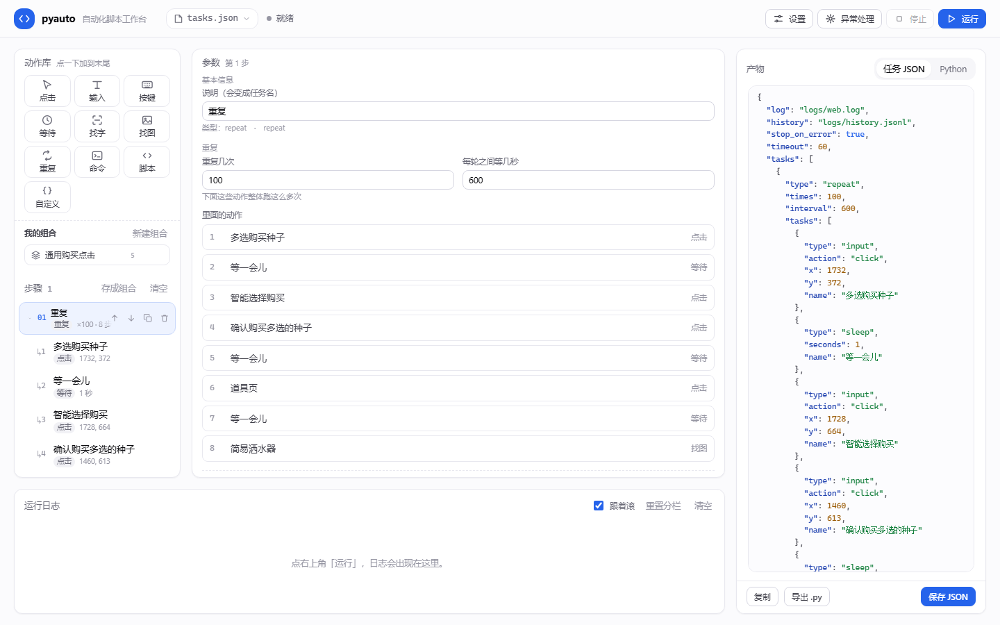

# pyauto 自动化工具箱

Windows 上的 Python 自动化工具箱：**OCR（免安装，用系统自带 Windows OCR）+ 定时任务 + 桌面点击/输入 + 找图 + 安卓 adb 控制**，带两个编辑器：

- **网页版工作台**（`pyauto web`）：动作库、步骤编排、可视化参数、实时 JSON / Python 双产物、组合片段、异常处理规则、日志面板，支持拖动分栏、主题配色、快捷键。
- **桌面版编辑器**（`pyauto gui`）：Tk 三栏，轻量、离线、F9/F10 全局启停。



## 快速开始

```bat
pyauto.cmd doctor          :: 自检：Python / Pillow / Windows OCR 语言
pyauto.cmd gui             :: 桌面版编辑器
pyauto.cmd web             :: 网页版，浏览器打开 http://127.0.0.1:8937/
pyauto.cmd run tasks.json  :: 跑任务文件
pyauto.cmd selftest        :: 离线自检（9 项）
```

没有参数时 `pyauto.cmd` 会进一个命令提示符，可以直接敲 `doctor` / `web` / `run xx.json`。

### 环境要求

- Windows 10 / 11
- Python 3.10+（3.12 已验证），**不需要 pip 装任何 OCR 库**
- 可选：Pillow（截图/标注/找图预处理）、numpy（找图 FFT 加速）

`pyauto.cmd` 找 Python 的顺序：`PYAUTO_PYTHON` 环境变量 → DeepSeek Harness 自带运行时 → PATH 里的 `python`。

```bat
set PYAUTO_PYTHON=C:\Python312\python.exe
```

## 它能干什么

| 能力 | 说明 |
| --- | --- |
| OCR | 系统 Windows.Media.Ocr（en-US / zh-Hans-CN），中文自动压缩字间空格，坐标可映射回原图 |
| 找图 | 纯 numpy FFT 模板匹配，先原尺寸快找、再 0.9/1.1/0.8/1.25 倍缩放回退；可叠加「同时看到某段文字」 |
| 点击/输入 | ctypes 调 user32，支持中文输入（SendInput Unicode） |
| 定时 | `every 30s` / `daily 09:30` / `cron */5 * * * *`；重复块还支持 `at`（18:00 / 18:00Z）+ `every` + `times` |
| adb | 截图、点击、滑动、输入、UI 树；|
| 任务编排 | shell / python / ocr / image / repeat / group / input / adb / sleep，支持重试、超时、跳过、异常处理规则 |

更多细节见 [pyauto/README.md](pyauto/README.md)（OCR 原理、任务字段表、调度表达式、找图/组合/异常处理、HTTP 接口表）。

## 目录

```
pyauto/            主程序包（cli / runner / ocr / imagefind / studio / webserver / adb / scheduler）
pyauto/web/        网页版前端（HTML / CSS / 原生 ES modules）
pyauto/docs/       文档截图
pyauto/examples/   示例任务与脚本
templates/         找图模板图
pyauto.cmd         命令行入口
tasks.json         示例任务文件
combos.json        组合片段
```

## 说明
-由于我自己发现问题太少了，而且一次就只改一点，所以我放到GitHub上让你们提交一点issues（偷笑）
