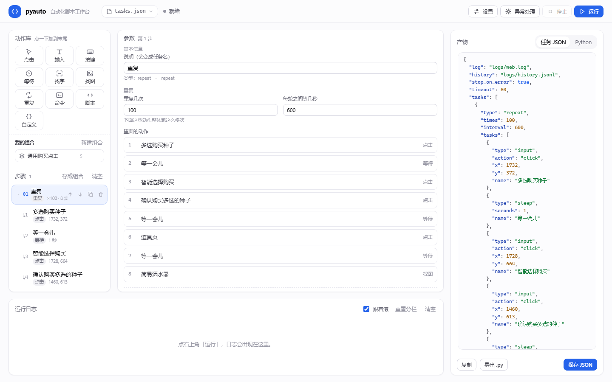
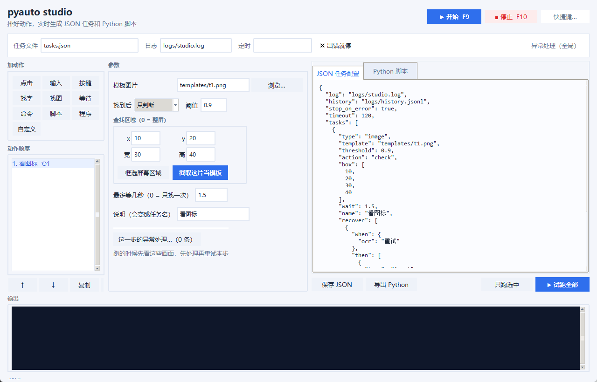
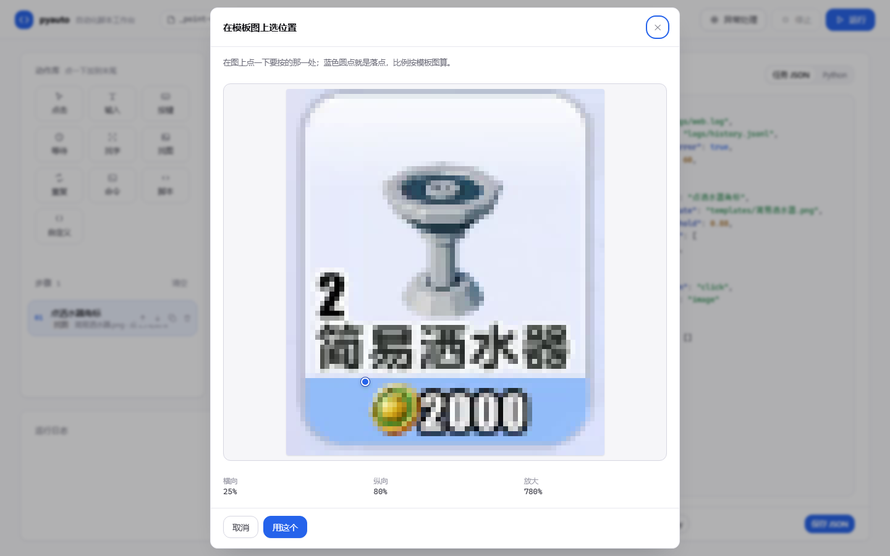
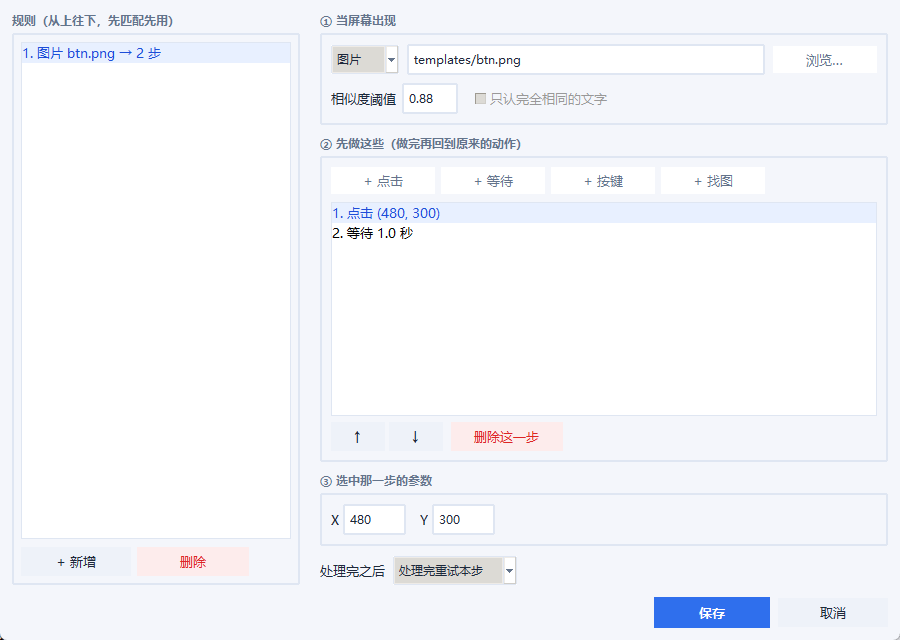
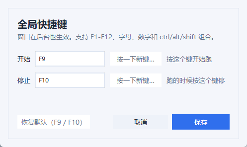

# pyauto — 脚本自动化工具箱

三块积木，可以单用也可以串起来：

| 模块 | 作用 |
| --- | --- |
| `pyauto.ocr` | 用 **Windows 自带 OCR** 把图片/屏幕变成带坐标的文字（免安装、离线、中英文） |
| `pyauto.runner` | 用一份 JSON 描述一串任务（shell / python / OCR / sleep），带超时、重试、日志、历史 |
| `pyauto.scheduler` | 按间隔、每天定时或 cron 反复执行这份 JSON |
| `pyauto.actions` | 鼠标点击、移动、键盘输入（支持中文）、全局热键 |

## 为什么不用 Tesseract

这台机器上既 **没有 tesseract**，也 **没有外网**（pip 走 HTTPS 直接 SSL 失败），所以装不了任何 OCR 库。
于是直接调用 Windows 10/11 内置的 `Windows.Media.Ocr`：

```
Python ──subprocess──> powershell.exe 5.1 ──WinRT──> OcrEngine ──JSON──> Python
```

- 必须走 `powershell.exe`（5.1）：PowerShell 7 没有 WinRT 类型投影，`[Windows.Media.Ocr.OcrEngine, Windows.Foundation, ContentType=WindowsRuntime]` 直接找不到类型。
- PS 5.1 按 **ANSI** 读取 `.ps1`，所以 `pyauto\winocr.ps1` 里 **不能出现一个中文字符**，否则解析会报「表达式或语句中缺少右 '}'」。
- 结果通过 **stdout** 回传（`##PYAUTO##` 起标记 + JSON），不写临时文件——受限环境下子进程写 `%TEMP%` 会被拒绝。
- 读图不用 `StorageFile`（对 `Documents` 路径会抛 `UnauthorizedAccessException`），改成 `File.ReadAllBytes` → `MemoryStream` → `AsRandomAccessStream` 交给 `BitmapDecoder`。

## 快速开始

在这个目录（`pyauto` 包的上一层）执行。**请用 `pyauto.cmd`**，不要用 PATH 上的 `python`：

```bat
pyauto.cmd doctor                        :: 自检：OCR 引擎、语言、Pillow
pyauto.cmd gui                           :: 打开桌面版编辑器（Tk）
pyauto.cmd web                           :: 打开网页版（浏览器里编辑、运行）
pyauto.cmd ocr shots\shot.png            :: 识别一张图
pyauto.cmd ocr --screen                  :: 先截屏再识别
pyauto.cmd ocr shots\shot.png --find 同意 --click
pyauto.cmd run pyauto\examples\tasks.json
pyauto.cmd schedule pyauto\examples\tasks.json --every 5m
```

`pyauto.cmd` 按顺序找解释器：`%PYAUTO_PYTHON%` → DSH 自带运行时 → PATH 上的 `python`。
本机 PATH 上的 `python.exe` 是 WindowsApps 存根，在这种受限环境里会报
`Access to the path '\\.\pipe\LOCAL\dotnet_…' is denied`，所以别直接用它。

**双击 `pyauto.cmd`（不带参数）**：会进一个小命令行，窗口不会一闪就关，直接敲命令就行（不用带 `pyauto.cmd` 前缀）：

```text
pyauto> gui                 :: 打开桌面版编辑器
pyauto> web                 :: 打开网页版
pyauto> run tasks.json      :: 跑任务
pyauto> cd C:\某目录          :: 切目录（pwd 看当前目录、cls 清屏）
pyauto> help                :: 再看一遍菜单
pyauto> exit                :: 退出
```

任何命令出错时，窗口也会停住等你按一下键；在脚本里调用想跳过这个停顿，设 `PYAUTO_NO_PAUSE=1`。

等价写法（任意 Python 3.10+）：

```bat
python -m pyauto doctor
```

## 命令

### doctor

```bat
pyauto.cmd doctor                 :: 看引擎/语言/Pillow
pyauto.cmd doctor shot.png        :: 顺便试识别一张
```

### ocr

```bat
pyauto.cmd ocr <图片或目录> [选项]
```

| 选项 | 说明 |
| --- | --- |
| `--screen` | 截取全屏再识别（`--box` 可指定区域） |
| `--lang auto\|zh-Hans-CN\|en-US` | 默认 `auto`：优先中文，没有中文语言包才退回英文 |
| `--scale auto\|2` | `auto` 会把长边缩放到 900–4000 再识别（太小放大更准，太大降采样更快） |
| `--box x,y,w,h` | 只识别这块区域（**原图坐标**，输出坐标也已换算回原图） |
| `--enhance` | 灰度 + 提高对比度，适合低对比截图 |
| `--engine auto\|windows\|tesseract` | 默认 `auto`：能用 Windows OCR 就用 |
| `--json` | 输出完整结构（每行、每字的坐标） |
| `--raw` | 保留引擎原始的「逐字加空格」中文 |
| `-o FILE` | 结果写文件（目录自动创建） |
| `--find 文本` | 在结果里找文字，打印中心坐标；**完全相等的行排在最前**，点按钮不会点到正文 |
| `--click` | 配合 `--find`，找到就点第一个（真的会动鼠标） |
| `--annotate out.png` | 把识别框画到图上，用来校验坐标 |
| `--device` | 先从 adb 设备（模拟器/真机）截图再识别，坐标是设备像素 |
| `--serial 地址` | 指定设备，如 `127.0.0.1:16384`；默认自动找唯一在线设备 |
| `--wait 秒` | 设备截图前等画面稳定（默认 5 秒，游戏每帧都在动，直接截容易抓到动画中间态） |
| `--no-wait` | 不等稳定，立刻截 |

退出码：`0` 正常，`1` 出错，`3` 没找到（`--find` 未命中）。

### image

不用 OCR、直接按像素找图（numpy FFT 归一化互相关，**不需要 OpenCV**）：

```bat
pyauto.cmd image grab --box 100,200,300,80 -o templates\按钮.png   :: 从屏幕上截一块当模板
pyauto.cmd image find templates\按钮.png                             :: 只找，打印坐标
pyauto.cmd image find templates\按钮.png --click                     :: 找到就点中心
pyauto.cmd image find templates\按钮.png --wait 10 --box 0,0,1280,400 :: 在这块里最多等 10 秒
```

| 选项 | 说明 |
| --- | --- |
| `--box x,y,w,h` | 只在这块区域里找（模板也是在这块里抓的） |
| `--threshold 0.85` | 相似度下限，默认 0.85；要更严给 `0.9+` |
| `--wait 秒` | 轮询等它出现，默认 0 只找一次 |
| `--max N` | 最多返回几个命中 |
| `--click` | 找到就点第一个的中心 |
| `--annotate out.png` | 把命中框画出来 |
| `--json` | 完整字段（x/y/w/h/score/scale/cx/cy） |

默认先按原尺寸快找（一张 1080p 截图约 0.25 s），找不到再依次试 0.9 / 1.1 / 0.8 / 1.25 倍缩放，
所以窗口缩放、分辨率变化也能命中。退出码：`0` 找到，`3` 没找到。

### run

```bat
pyauto.cmd run tasks.json [--only 任务名 任务名] [--dry-run] [-q]
pyauto.cmd run tasks.json --only 截屏,识别        :: 逗号也行
```

### schedule

```bat
pyauto.cmd schedule tasks.json --every 5m
pyauto.cmd schedule tasks.json --cron "*/10 * * * *"
pyauto.cmd schedule tasks.json --at 09:30
pyauto.cmd schedule tasks.json --every 30s --now --max-runs 3   :: 调试：先跑一次，共 3 次
```

调度表达式也可以写在配置里：`"schedule": "every 5m"`。

### init

```bat
pyauto.cmd init 某目录          :: 生成 tasks.example.json
pyauto.cmd init 某目录 --force  :: 覆盖已有
```

### selftest

```bat
pyauto.cmd selftest   :: 9 项离线自检：导入/文本清理/UI 解析/调度/配置/OCR/找图/studio 规则/adb
```

不联网、不需要设备也能跑；没设备时 adb 那项只提示不算失败。改完代码先跑它。

### web

```bat
pyauto.cmd web                       :: 起本地服务并打开浏览器（默认 8937）
pyauto.cmd web --port 9000           :: 换个端口（被占用会自动往后找）
pyauto.cmd web --no-browser          :: 只起服务，不开浏览器
pyauto.cmd web --config 别的.json    :: 打开别的任务文件
```

## 网页版（pyauto web）

浏览器里编辑、预览、运行，不用开桌面窗口。服务只监听 `127.0.0.1`，不对外网开放。

```bat
pyauto.cmd web
:: pyauto web 已启动：http://127.0.0.1:8937/
```



四个区块：

| 区块 | 内容 |
| --- | --- |
| 左：动作库 / 步骤 | 十个动作按钮（含「重复」），点一下加到末尾；步骤列表用 ↑↓ 切换、Delete 删除 |
| 中：参数 | 当前步骤的所有字段；坐标可以「在屏幕上取坐标」，也可以框一个区域 |
| 右：产物 | 任务 JSON / Python 源码实时切换，可复制、导出、保存 |
| 下：运行日志 | 运行/停止按钮触发的任务日志，按 OK / WARN / ERR / 规则 上色 |

**拖动边界**：左栏、右栏、日志高度这三条边界都能拖，双击复位，键盘聚焦后用方向键微调（按住 Shift 一次 48px）。尺寸存在浏览器本地，下次打开还是这个比例；拖乱了点日志栏右上角的「重置分栏」一键回到默认比例（左 240 / 右 360 / 日志 180）。窗口变窄或浏览器放大到 125% 时，两侧会自动收窄，中间那栏不会被挤没。

**快捷键**：`Ctrl/Cmd + S` 保存、`Ctrl/Cmd + Enter` 运行、`F9` 启动、`F10` 停止（窗口在前台时生效；F9/F10 可以在「设置」里改）。

**设置（顶栏「设置」）**：

| 分组 | 能改什么 |
| --- | --- |
| 界面 | 主题色（蓝/青/紫/墨）、字号 12–15px、密度（紧凑/宽松），存在浏览器本地 |
| 快捷键 | 启动 / 停止用哪个键，默认 F9 / F10 |
| 运行默认 | 单步超时、失败重试次数、重试间隔、出错就停、出错时先跑全局异常处理——这些写进当前任务文件 |
| 文件 | 显示工程目录，便于知道任务/模板/组合存在哪 |

**改完代码要重启**：网页只是前端，跑任务的是后台那个 `pyauto web` 进程。改了 `pyauto/` 里的 Python 代码（runner、webserver 等）之后，光刷新页面没用——先把原来那个进程停掉再 `pyauto.cmd web`。页面会自己检测：如果后台代码比进程新，右下角会弹一条「后台代码更新过，重启 pyauto web 之后新功能才会生效」。

**多个任务文件**：顶栏的文件名是一个菜单（`tasks.json  ▾`），里面列出工程根目录下所有「像任务文件」的 json（有 `tasks` 数组的），点谁就切到谁；输入框里写个名字按「新建」会建好并直接切过去（重名会被拦下）。地址栏加 `?file=别的.json` 也能直接打开某个文件，方便收藏。

**组合（把常用几步存起来）**：老要重复搭同样的几步时，别每次重敲——
组合就摆在**动作库下面「我的组合」**里，跟动作一样点一下就用：

1. 选中要收进组合的那段：点第一个步骤，按住 `Shift` 再点最后一个（蓝色高亮）；
2. 点步骤区右上角「存成组合（N 步）」，或直接点「我的组合」标题旁的「新建组合」→ 弹层里能看到这段是哪几步，起个名字存下；
3. 之后点「我的组合」里的胶囊，**整段会收成一个「组合块」**插在当前选中步骤的后面（默认收起，只占一行；点左边的箭头展开看里面几步）；
   - 选中的是「重复」块本身 → 步骤直接摊进这个重复块（不再套一层组合块）；
   - 选中的是块里某一步 → 就插在那一步后面；
4. 组合块可以改名（参数区「这一项叫什么」）、往里再加步骤（「再加一步：」一排按钮）、收起/展开、整体上移/下移或删除；
5. 胶囊右侧的铅笔可以改名/改内容（改名字会另存一份并删掉旧的），🗑 只删组合本身，不动当前任务。

组合块的 JSON：

```json
{"name": "组合：购买物品通用点击", "type": "group",
 "tasks": [{"type": "input", "action": "click", "x": 1307, "y": 498},
           {"type": "sleep", "seconds": 1}]}
```

组合存在工程根目录的 `combos.json`，所有任务文件共用——所以在 `tasks.json` 里存的组合，切到别的 json 也还在。接口是 `GET /api/combos`、`POST /api/combos`、`POST /api/combos/delete`。

**写到哪里**：

- 任务文件：顶栏选中的那个 json（默认 `tasks.json`），右栏「保存 JSON」写它
- 日志：`logs/web.log`，历史：`logs/history.jsonl`
- 模板图：`templates/`（「截取模板」直接截屏存这里；「浏览文件…」会把磁盘上的图复制一份过来）
- 组合：工程根目录的 `combos.json`（所有任务文件共用）

**找图模板的两种来路**：

| 按钮 | 干什么 |
| --- | --- |
| 截取模板 | 弹全屏截图，拖一块框，存成 `templates/tpl_月日_时分秒.png` |
| 浏览文件… | 选磁盘上的 PNG/JPG/WebP/BMP，后端解码后统一转 PNG 存进 `templates/`；重名自动加 `_2`、`_3`，非图片文件会被拒绝（上限 12 MB） |

**重复块**：动作库里的「重复」放进去是一段容器，把动作装进它里面整体跑 N 次。加动作有三个入口——空块的列表下方会直接列出十种动作，点一个就加进去；参数区「里面的动作」底部有「再加一步：」一排小按钮；正在改块里的某一步时，点左边动作库也会继续加进这个块。想再加一个**并列**的重复块，就把重复块本身选中（不要在改块里的某一步），再点动作库的「重复」。块里的动作在列表里显示成 `↳1`、`↳2` 的缩进行；参数区能改「重复几次」「每轮之间等几秒」，点列表里的某一步进去改它自己的参数，顶部的「返回…」退回重复块。JSON 里长这样：

```json
{"name": "刷五次", "type": "repeat", "times": 5, "interval": 0.5,
 "tasks": [{"type": "input", "action": "click", "x": 900, "y": 620},
           {"type": "sleep", "seconds": 1}]}
```

**按时间跑（定时重复）**：重复块除了「跑 N 次、每轮隔几秒」，也能按钟点来：

| 想要的效果 | 填法 |
| --- | --- |
| 18:00 起，每 10 分钟跑一次，共 5 次 | 开始时间 `18:00`、每隔 `10m`、共 `5` 次 |
| 每 10 分钟跑一次，现在就开始 | 开始时间留空、每隔 `10m`、共 `N` 次 |
| 只跑一次，18:00 开始 | 开始时间 `18:00`、每隔留空、共 `1` 次 |
| 按 UTC 时间 18:00 | 开始时间写 `18:00Z`（会自动换算成本地时间） |

- 开始时间写了但今天已经过了 → 顺延到明天，日志里会说明；
- 间隔写法：`30s`、`10m`、`2h`，也可以直接写秒数 `600`；
- 等待期间日志会打「等到 18:10（还有 7 分 12 秒）」，点「停止」能立刻打断等待；
- JSON 字段就是 `at` / `every` / `times`：

```json
{"name": "定点跑", "type": "repeat", "at": "18:00", "every": "10m", "times": 5,
 "tasks": [{"type": "input", "action": "click", "x": 900, "y": 620}]}
```

**找不到就跳过**：找图、找字都有这个勾选（`allow_missing: true`）。勾上以后没找到不算失败，日志打一行 `SKIP`，接着跑下一步——适合「有广告就关、没有就继续」这种可选步骤；不勾的时候找不到就是失败，会按你的设置重试或停下。

**后端接口**（都在 `127.0.0.1` 上，前端只走这些）：

| 方法 | 路径 | 作用 |
| --- | --- | --- |
| GET | `/api/meta` | 版本、Python、OCR 语言、Pillow |
| GET/POST | `/api/config` | 读 / 写任务 JSON |
| GET | `/api/files?path=…` | 列出可选的任务 json（带每个文件几步） |
| POST | `/api/file/new` | 新建任务文件（重名会被拦下） |
| POST | `/api/preview` | 生成 Python 源码 + 步骤数 |
| POST | `/api/run` `·` `/api/stop` | 运行 / 停止 |
| GET | `/api/state` | 状态、摘要、事件序号 |
| GET | `/api/events?since=N` | SSE 推日志 |
| POST | `/api/screenshot` `·` `/api/template` | 截屏取坐标 / 截模板图 |
| POST | `/api/template/upload` | 上传本地图片，复制进 `templates/` |
| GET | `/api/templates` | 模板列表 |
| POST | `/api/ocr` | 单张图 OCR |

## 可视化编辑器（studio）

不想手写 JSON 或 Python 时，用这个窗口点出来：

```bat
pyauto.cmd gui                 :: 打开空白工程
pyauto.cmd gui tasks.json      :: 打开已有配置继续改
```



窗口分三栏：

| 栏 | 干什么 |
| --- | --- |
| 左 | 「加动作」十宫格，点一下往列表里加；↑↓ 调顺序，复制/删除 |
| 中 | 当前动作的参数。「拾取坐标」倒数 3 秒后把鼠标位置读进来；「框选屏幕区域」会全屏变暗让你拖一个框，坐标自动填好 |
| 右 | 同一份动作实时生成两种产物：`JSON 任务配置` 和 `Python 脚本`，各有一个保存/导出按钮 |

顶部一排是 `▶ 开始 F9`、`■ 停止 F10`、`快捷键…`、`异常处理（全局）`，下面一条是工程设置
（任务文件、日志、定时、出错就停）。底部是深色的「输出」和「试跑」。

### 动作对应关系

| 动作 | 生成的任务 | 生成的 Python |
| --- | --- | --- |
| 点击 | `{"type":"input","action":"click","x":..,"y":..}` | `actions.click(x, y)` |
| 输入 | `{"type":"input","action":"type","value":".."}` | `actions.type_text('..')` |
| 按键 | `{"type":"input","action":"key","value":"ctrl+s"}` | `actions.hotkey('ctrl', 's')` |
| 找字 | `{"type":"ocr","screen":true,"expect":"..","click":true,"box":[..]}` | `ocr.recognize(...)` + `res.find(..)` + `actions.click(*hit[0].center)` |
| 找图 | `{"type":"image","template":"templates/a.png","action":"click","threshold":0.88}` | `imagefind.find('templates/a.png')` + `actions.click(*hits[0].center)` |
| 等待 | `{"type":"sleep","seconds":1.5}` | `time.sleep(1.5)` |
| 命令 | `{"type":"shell","cmd":".."}` | `subprocess.run('..', shell=True, check=True)` |
| 脚本 | `{"type":"python","script":".."}` | `subprocess.run([sys.executable, '..'], check=True)` |
| 程序 | `{"type":"shell","cmd":"start \"\" \"..\""}` | `os.startfile('..')` |
| 自定义 | 直接写任务 JSON 对象 | 生成注释，留给你自己补 |

「找字」动作点开后有 **查找区域**：留 `0 0 0 0` 是整屏，填了只在那块里识别——又小又快，还能避开屏幕上别处的同名文字。

### 找图动作

「找图」不认字、只认像素，适合按钮/图标/游戏界面这类 OCR 读不准的东西。模板图片有两种办法：

1. 点「浏览…」选一个现成的 PNG；
2. 点「截取这片当模板」——在屏幕上拖一个框，马上存成 `templates/tpl_月日_时分秒.png`。

「找到后」可以选 **点一下 / 双击 / 只判断**；「阈值」默认 0.88（越高越严）；
「最多等几秒」填了就会等它出现（0 = 只找一次）。

**点在图片的哪一处**：默认点命中区域的**正中**。有些图标的按钮在小角上、或者整块图只有一角能点，
这时选「自己指定一处」——**会在网页里用大图打开模板**，在图上点一下，蓝色圆点就是落点，
读一行会显示「横向 25%、纵向 80%」这样的比例。也可以随时点旁边的「在网页里打开大图」重选。



比例是相对模板图的，所以换分辨率、或者靠缩放才命中的时候，落点还是同一处。

```json
{ "type": "image", "template": "templates/buy.png", "action": "click", "point": [0.25, 0.8] }
```

`point` 是 `[横向比例, 纵向比例]`，0–1，相对模板图左上角；不写就是正中 `[0.5, 0.5]`。

**同时要看到文字**：填了这段字，就要求「图和字同时出现」才算命中——图片长得像的地方很多，
加一层 OCR 复核能明显少点错。勾上「只认完全相同的文字」就是整行完全一致才算。

```json
{ "type": "image", "template": "templates/buy.png", "expect": "立即购买", "action": "click" }
```

**框选可以再调**：拖完一个框之后别急着确认——拖框内部能整块挪，拖八个角上的小方块能放大缩小，
框左上角实时显示当前尺寸，读一行「坐标 / 区域」也会跟着变。重新点「框选」时会带着上次的框打开。

**点完图之后接着做**：找图这一步还能挂一段「后续动作」——在「点完图之后（可选）」里从组合中挑一个，
它的步骤就会被复制进这一步的 `then` 数组；命中并点击之后，按顺序把这些动作跑完，再往下走。
后续动作用的是当时那份拷贝，之后改组合不会影响已经存下的任务。

```json
{"type": "image", "template": "templates/buy.png", "action": "click",
 "then": [{"type": "input", "action": "click", "x": 960, "y": 540},
          {"type": "sleep", "seconds": 0.8}]}
```

后续动作里某一步失败，会报「点完之后的第 N 个动作「x」失败：…」。

### 异常处理（因果规则）

脚本点是点在某个位置上，可屏幕上要是突然弹出个公告、验证码、「确定」按钮，接着的动作就会点错地方。

这套规则就是给这种情况用的：**当出现 X（图片或文字）→ 先做这几步 → 再回来重试本步**。
每个动作执行前，先按顺序检查「这一步的规则」和「全局规则」，命中了就把「先做这些」跑完，
然后回到原动作重新执行；末尾还能选「处理完跳过本步」。

- 全局规则：顶栏 `异常处理（全局）`；
- 单步规则：参数区底部的 `这一步的异常处理…`，列表里会用 `⟲n` 标出来这条动作配了几条。

规则窗口里用 `+ 点击 / + 等待 / + 按键 / + 找图` 拼处理步骤，↑↓ 调顺序。



### 快捷键

| 键 | 作用 |
| --- | --- |
| `F9` | 开始跑（**窗口在后台也生效**） |
| `F10` | 停止，当前这一步做完就停（等待中的会立刻打断） |
| `Ctrl+S` / `Ctrl+Enter` | 保存 JSON / 试跑全部 |

点顶栏 `快捷键…` 可以改成任意组合键（支持 `ctrl` / `alt` / `shift` + F1-F12/字母/数字），
设置存在工程根的 `.pyauto_studio.json`，下次打开自动生效。



> studio 只是个「生成器」：保存出来的 `tasks.json` 用 `pyauto run` 跑，导出的 `.py` 用 python 直接跑，都不依赖这个窗口。

## 模拟器 / 真机（adb）

要在模拟器里跑脚本，**用 adb 模式，不要在窗口上截屏点鼠标**。两者对比：

| | 窗口模式（`--screen` / `actions.click`） | adb 模式（`--device` / `adb` 任务） |
| --- | --- | --- |
| 截图来源 | 桌面截屏，含窗口边框、缩放、遮挡 | 设备帧缓冲（`screencap`），就是设备分辨率 |
| 点击方式 | 鼠标事件，坐标要先换算窗口内偏移 | `input tap x y`，设备像素，和窗口无关 |
| 窗口最小化 | 失效 | 照常工作 |
| 换分辨率/换模拟器 | 坐标全要重标 | 坐标跟着设备走，`wm size` 自动读 |
| 找控件 | 只能 OCR | 优先读 uiautomator 控件树，没有树再 OCR |

### 常用命令

```bat
pyauto.cmd adb devices                  :: 列出设备（会自动 adb connect 常见模拟器端口）
pyauto.cmd adb connect 127.0.0.1:16384  :: MuMu 12 默认端口
pyauto.cmd adb size                     :: 分辨率
pyauto.cmd adb current                  :: 当前前台应用
pyauto.cmd adb shot -o shot.png         :: 设备截图
pyauto.cmd adb ui -o ui.xml             :: 控件树原始 XML
pyauto.cmd adb find 开始 --click        :: 按文字找控件并点击（原生界面有效）
pyauto.cmd adb tap 540 1600             :: 按坐标点
pyauto.cmd adb swipe 700 1500 700 500 --ms 300
pyauto.cmd adb text hello               :: 仅 ASCII；中文需装 ADBKeyboard
pyauto.cmd adb key back                 :: back/home/enter 或 66 这种数字
pyauto.cmd adb start com.netease.party.huawei
pyauto.cmd adb launch --vmindex 0       :: 拉起 MuMu 并等设备上线
pyauto.cmd adb boot --timeout 180       :: 等系统启动完成
```

游戏画面按文字点（OCR 定位 + `input tap`）：

```bat
pyauto.cmd ocr --device --wait 5 --find 回家 --click
```

### 任务配置里怎么写

见 `examples\tasks.emulator.json`：

```json
{"name": "识别屏幕文字", "type": "ocr", "device": true, "wait": 5, "out": "logs/device.txt"},
{"name": "按文字点按钮", "type": "ocr", "device": true, "expect": "回家", "click": true},
{"name": "点坐标", "type": "adb", "action": "tap", "x": 540, "y": 1600},
{"name": "等界面出现", "type": "adb", "action": "wait", "target": "开始", "wait_timeout": 20}
```

`ocr` 任务加 `device: true` 后，`expect`/`click` 用的是设备坐标，点击走 `dev.tap()`。

### 三个限制（都踩过）

1. **游戏界面没有控件树**。蛋仔这类 Vulkan/自绘 UI，`uiautomator dump` 只有一层
   `FrameLayout`，`adb find`/`adb tap --text` 找不到东西（`ui` 会提示「0 个可读节点」）。
   这时用 OCR：`ocr --device --find 文字 --click`，或任务里 `expect` + `click`。
2. **必须等画面稳定**。游戏每帧都在动，直接截会抓到动画中间态，OCR 结果时多时少
   （实测同一界面 0/2/23/45 行）。`--device` 默认等 5 秒（连续两帧几乎一样才截），
   这个功能靠 Pillow；没有 Pillow 就退化成直接截。
3. **MuMuManager 在受限沙箱里起不来**（要开命名管道，被拒：
   `Access to the path '\\.\pipe\LOCAL\dotnet_…' is denied`）。所以在 DSH 的沙箱会话里
   `adb launch` 可能失败，直接手动开模拟器，或者在自己的普通终端里跑 `pyauto.cmd adb launch`。

中文输入：`adb shell input text` 只吃 ASCII。要输中文得给设备装
[ADBKeyboard](https://github.com/senzhk/ADBKeyBoard)，`Device.text()` 会自动切到它的输入法；
没装会明确报错，而不是静默乱码。

## Python 里直接用

```python
import pyauto

res = pyauto.recognize("shot.png")        # backend="windows"，lang="auto"
print(res.engine, res.lang, res.elapsed_ms)
print(res.text)                            # 已清理中文逐字空格

for hit in res.locate("同意"):             # [{text,x,y,w,h,cx,cy,level}]，原图坐标
    print(hit["text"], hit["cx"], hit["cy"], hit["level"])

hit = res.locate("同意")
if hit:
    pyauto.click(hit[0]["cx"], hit[0]["cy"])     # 会先 SetProcessDPIAware，坐标即物理像素
```

其他能用的：

```python
res.find("同意")           # -> [Line]，完全匹配在前
res.find_words("同意")     # -> [Word]，逐字级
res.mapped_lines()         # 坐标换算回原图后的 Line 列表
res.to_dict()              # 可 JSON 序列化的完整结果
pyauto.grab_screen()       # 截屏，返回临时 PNG 路径
pyauto.annotate(res, "out.png")
pyauto.type_text("你好，世界")   # SendInput + KEYEVENTF_UNICODE，能打中文
pyauto.hotkey("ctrl", "s")
pyauto.screen_size()
```

找图（不依赖 OpenCV）：

```python
from pyauto import imagefind

hits = imagefind.find("templates/btn.png", threshold=0.88)   # -> [Match(x,y,w,h,score,scale)]
if hits:
    hit = hits[0]
    print(hit.center, hit.score, hit.scale)                  # scale 是命中时用的缩放倍数
    pyauto.click(*hit.center)

imagefind.wait("templates/btn.png", timeout=10, interval=0.4)  # 等它出现，最多 10 秒
imagefind.screen_image([0, 0, 1280, 400])                     # 截一块 -> PIL.Image，可存成模板
```

任务也可以当库调：

```python
from pyauto import load_config, run_config, parse_spec, serve

cfg = load_config("tasks.json")
run_config(cfg, base_dir=".", only=None, dry_run=False)

serve(parse_spec("every 30m"), lambda: run_config(cfg, base_dir="."), max_runs=None)
```

## 任务配置格式

```jsonc
{
  "log": "logs/pyauto.log",          // 追加写，相对路径按「本文件所在目录」算
  "history": "logs/history.jsonl",   // 每个任务一行 JSON（dry-run 不记）
  "stop_on_error": false,            // 失败就停
  "schedule": "every 5m",            // 可选，schedule 子命令的默认表达式
  "tasks": [ /* ... */ ]
}
```

顶层除 `tasks` 外的键都会作为默认值套到每个任务上（`log`/`history`/`stop_on_error` 除外）。

### 通用字段

| 字段 | 默认 | 说明 |
| --- | --- | --- |
| `name` | 类型名 | 显示名，`--only` 用它匹配 |
| `type` | `shell` | `shell` / `python` / `ocr` / `image` / `repeat` / `group` / `input` / `adb` / `sleep` |
| `timeout` | `300` | 秒，超时算失败 |
| `retries` | `0` | 失败重试次数 |
| `retry_delay` | `2` | 重试间隔秒 |
| `cwd` | 配置目录 | 工作目录 |
| `env` | — | 追加的环境变量 |
| `enabled` | `true` | `false` 直接跳过 |
| `continue_on_error` | `false` | 即使 `stop_on_error` 也继续 |
| `traceback` | `false` | 失败时把完整堆栈塞进 error |

### 各类型

```jsonc
// shell：cmd 给字符串（走 shell=True）或数组
{"name": "清理", "type": "shell", "cmd": "del /q temp\\*.tmp"}

// python：script 或 code 二选一，args 追加在后面
{"name": "抓数据", "type": "python", "script": "fetch.py", "args": ["--today"]}
{"name": "内联", "type": "python", "code": "print(1 + 1)"}

// ocr：image 或 screen:true；out 写结果；expect 找不到就失败；click 找到就点
{"name": "点同意", "type": "ocr", "screen": true,
 "box": [0, 2000, 1280, 700], "expect": "同意", "click": true},
{"name": "存文字", "type": "ocr", "image": "shot.png", "out": "logs/ocr.txt"},

// sleep
{"name": "等一下", "type": "sleep", "seconds": 0.5}

// image：找图。template 是模板路径；action 为 click / double / check；
//        wait>0 时最多等这么久；allow_missing:true 时找不到也算过；
//        expect 填了就要求「图和这段字同时出现」才算命中（exact:true 整行完全一致）
{"name": "点开始", "type": "image", "template": "templates/start.png",
 "action": "click", "threshold": 0.88, "wait": 5},
{"name": "有没有弹窗", "type": "image", "template": "templates/ok.png", "action": "check"},
{"name": "点购买", "type": "image", "template": "templates/buy.png",
 "expect": "立即购买", "action": "click"},

// repeat：整段重复 N 次；group：组合块，里面这段依次跑一遍（网页版「我的组合」插进来的就是它）
{"name": "刷五次", "type": "repeat", "times": 5, "tasks": [{"type": "sleep", "seconds": 1}]},
{"name": "组合：领奖励", "type": "group",
 "tasks": [{"type": "input", "action": "click", "x": 900, "y": 620}]},

// input：模拟鼠标键盘（studio 的 点击/输入/按键 动作生成的就是它）
{"name": "点开始", "type": "input", "action": "click", "x": 120, "y": 340},
{"name": "双击", "type": "input", "action": "double", "x": 120, "y": 340},
{"name": "打字", "type": "input", "action": "type", "value": "hello 世界"},
{"name": "保存", "type": "input", "action": "key", "value": "ctrl+s"},

// adb：action 见下表；tap 可给 x/y 或 target 文字（原生界面才能按文字找）
{"name": "点开始", "type": "adb", "action": "tap", "target": "开始"},
{"name": "点坐标", "type": "adb", "action": "tap", "x": 540, "y": 1600},
{"name": "截设备", "type": "adb", "action": "shot", "out": "logs/device.png"},
{"name": "识别设备", "type": "ocr", "device": true, "wait": 5, "out": "logs/device.txt"},
{"name": "按文字点", "type": "ocr", "device": true, "expect": "回家", "click": true}
```

`adb` 任务的 `action`：`tap` / `swipe` / `longpress` / `text` / `key` / `shot` / `size` / `ui` /
`find` / `wait`（`target` + `wait_timeout`）/ `start`（`package`）/ `stop` / `current` / `boot` /
`launch`（`vmindex`）/ `shell`（`cmd`）。可选 `serial` 指定设备。

`python` 任务会自动带上 `PYTHONUTF8=1`、`PYTHONIOENCODING=utf-8`，中文输出不会乱码；
`shell` 任务的输出先按 UTF-8 解，失败再按 GBK 解。

### 变量（随机延时 / 时间戳）

`cmd`、`code`、`value`（输入内容）和 `sleep` 的 `seconds` 里可以写占位符，跑的时候才替换：

| 写法 | 换成 |
| --- | --- |
| `{random:1-5}` | 1~5 之间的随机整数；只写 `{random:5}` 就是 1~5 |
| `{now}` | `2026-11-25 18:02:33` |
| `{now:%Y%m%d}` | 自己定格式（strftime） |
| `{date}` | `2026-11-25` |

```json
{"name": "随机等一会儿", "type": "sleep", "seconds": "{random:2-5}"},
{"name": "留个记录", "type": "shell", "cmd": "echo 跑完于 {now}"}
```

### 异常处理（recover）

每个任务可以带 `recover`（只对这一步生效），顶层也可以带 `recover`（全局，所有任务都会先查一遍）：

```jsonc
{
  "recover": [                                   // 全局规则：按顺序先匹配先执行
    {"when": {"image": "templates/announce.png", "threshold": 0.88},
     "then": [{"type": "input", "action": "click", "x": 640, "y": 620},
              {"type": "sleep", "seconds": 1}],
     "then_action": "retry"}                     // 处理完回到原动作重试（默认）；skip = 跳过原动作
  ],
  "tasks": [
    {"name": "点领取", "type": "image", "template": "templates/claim.png",
     "action": "click",
     "recover": [
       {"when": {"ocr": "取消", "exact": true},
        "then": [{"type": "input", "action": "click", "x": 100, "y": 100}],
        "then_action": "skip"}
     ]}
  ]
}
```

- `when`：`{"image": 模板, "threshold": 0.88}` 或 `{"ocr": 文字, "exact": true}`。
- `then`：要执行的步骤，写法和普通任务一样（`input` / `sleep` / `image` / `shell` …）。
- `then_action`：`retry`（默认，处理完重试原动作）或 `skip`（处理完直接算这一步过了）。
- 最多连续触发 3 次，避免「一直弹窗 → 一直重试」死循环。

**出错时也走全局异常处理**：顶层加 `"recover_on_error": true`（默认就是 true，网页版「整体设置」里是那个勾选）。

```jsonc
{"recover_on_error": true, "stop_on_error": true,
 "recover": [{"when": {"ocr": "我知道了"},
              "then": [{"type": "input", "action": "click", "x": 640, "y": 720}]}]}
```

某一步失败时，先把这个全局规则跑一遍（关弹窗、点「重试」之类），然后**重试刚才那步**；重试成功了就继续，还失败就记一条 WARN **接着跑后面的步骤**，不会因为 `stop_on_error` 整份停在这里。日志长这样：

```text
WARN  RECOVER 命中「我知道了」，先执行处理动作
WARN  已处理「我知道了」，重试这一步
OK    点领取 (0.42s) -> 找到 templates/claim.png（0.961）
```

没有配全局规则、或者 `recover_on_error: false` 时，行为还是原来的：按 `stop_on_error` 决定停不停。

示例见 `pyauto\examples\tasks.json`（桌面模式）和 `pyauto\examples\tasks.emulator.json`（模拟器），
可直接 `pyauto.cmd run pyauto\examples\tasks.emulator.json`。

## 调度表达式

| 写法 | 含义 |
| --- | --- |
| `every 30s` / `every 5m` / `every 2h` / `every 1d` | 固定间隔 |
| `daily 09:30` / `at 23:15` / `09:30` | 每天这个点 |
| `cron */10 * * * *` | 5 段 cron（分 时 日 月 周），支持 `*/n`、`a-b`、`1,3,5`、`mon-fri` |
| `once` | 只跑一次 |

`--now` 让调度器启动时先立刻跑一次。

## 常见坑（踩过的）

1. **`winocr.ps1` 必须纯 ASCII**：PS 5.1 按 ANSI 读脚本，中文注释会让它解析失败。
   `.cmd` 同理（`pyauto.cmd` 里只有英文）。
2. **别在 pwsh 里 `原生命令 2>&1 | ...`**：受限环境下管道要开命名管道，会被拒
   （`Access to the path '\\.\pipe\LOCAL\dotnet_…' is denied`）。要捕获输出就用 Python `subprocess`，或者直接写文件。
3. **系统 OCR 会给中文单字插空格**（`应 用 市 场`）：`clean_text()` 会压回去，但正则里只能用 `[ \t\u00a0]`，
   千万别用 `\s`——它会把换行也吃掉，把「取消」和「同意」粘成一行。
4. **`StorageFile.GetFileFromPathAsync` 读 `Documents` 会被拒**：用内存流那条路。
5. **坐标是物理像素**：导入 `pyauto.actions` 时会 `SetProcessDPIAware()`，OCR 的坐标可以直接拿去点。
6. 识别速度参考：一张 1280×2832 的截图约 0.2 s；全屏截屏（`--screen`）约 0.9 s。
7. **找图先试原尺寸再试缩放**：原尺寸约 0.25 s；缩放命中时返回的是「屏幕上的实际大小」，
   中心点仍然对得上（早期版本把框强行改回模板尺寸，点坐标会偏几十像素）。
8. **快捷键是 `GetAsyncKeyState` 全局轮询**（窗口在后台也响应），窗口有焦点时另有一层 Tk 绑定兜底。
   用 `keybd_event`/`SendInput` 注入的假按键常常读不到，别拿它测热键；真人按 F9/F10 是好的。

## 目录

```
pyauto.cmd              启动器（找解释器 + 设 UTF-8 + 带上 PYTHONPATH）
pyauto\
  __init__.py           对外 API
  __main__.py           python -m pyauto
  cli.py                doctor / ocr / image / run / schedule / init / adb / gui / web / selftest
  studio.py             桌面版编辑器（tkinter）：拖动作 → 实时出 JSON + Python
  webserver.py          网页版后端：静态文件 + JSON 接口 + SSE 日志
  web\                  网页版前端（原生 ES 模块，无构建步骤）
    index.html
    css\tokens.css      设计令牌（颜色/间距/圆角/阴影/动效）
    css\app.css         布局与组件
    js\app.js           入口：渲染、事件、运行/保存
    js\api.js           fetch 封装 + SSE
    js\store.js         状态与任务增删改
    js\layout.js        三条可拖动边界（存 localStorage）
    js\dom.js           h() 建 DOM 的小工具
    js\icons.js         内联 SVG 图标
    js\toast.js         轻提示
    js\views\           library / editor / preview / console / picker / rules
  ocr.py                OCR 封装：缩放、裁剪、坐标换算、文本清理、查找
  winocr.ps1            WinRT OCR 桥（ASCII-only）
  imagefind.py          找图：FFT 归一化互相关 + 缩放回退 + 等待出现
  adb.py                adb 通道：截图、点击、输入、控件树、MuMu 启动
  runner.py             任务执行器 + 配置加载 + 异常处理（recover）+ 随时停止
  scheduler.py          间隔 / 每日 / cron 调度
  actions.py            鼠标键盘（ctypes + SendInput）
  selftest.py           离线自检（不联网、不需要设备）
  templates\            找图模板（studio 的「截取这片当模板」存这里）
  docs\                 截图
  examples\
    tasks.json          桌面模式的示例任务
    tasks.emulator.json 模拟器/真机的示例任务
    tasks.image.json    找图 + 异常处理的示例
    hello.py            示例脚本
    logs\               示例产生的日志/OCR 输出/历史
```
